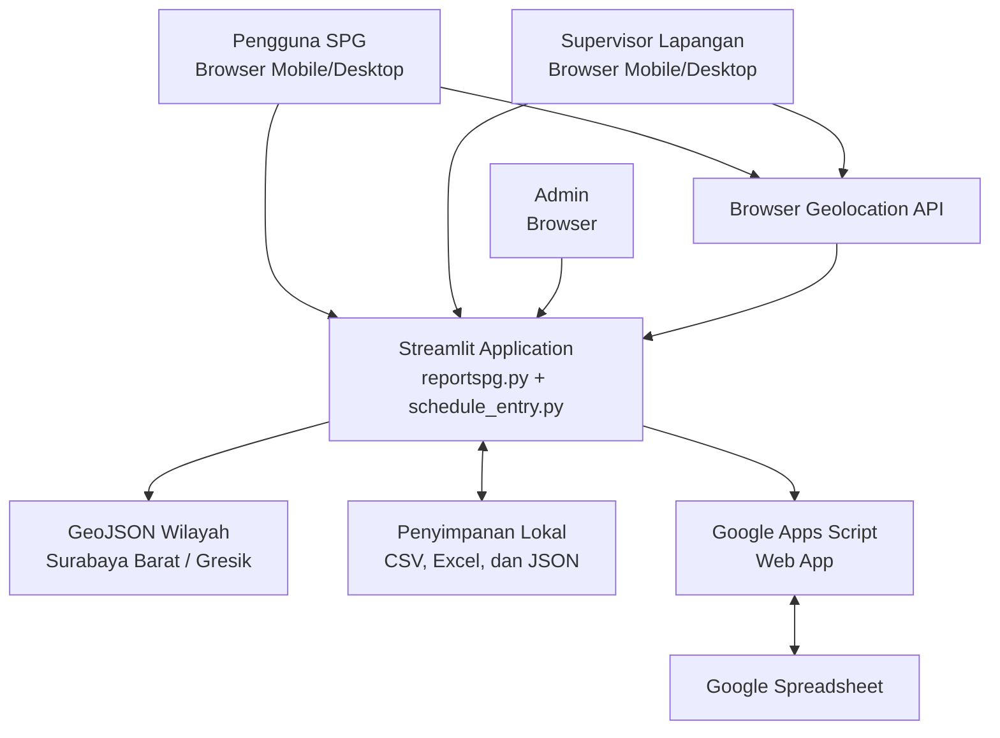
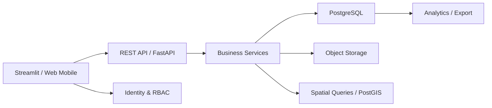

# Laporan SPG

Dokumentasi arsitektur sistem monitoring, jadwal, dan pelaporan SPG.

## Gambaran Sistem

Laporan SPG adalah aplikasi berbasis Streamlit yang dijalankan sebagai satu proses
web aplikasi. Sistem memiliki tiga peran utama:

- **SPG**: memilih lokasi berdasarkan jadwal, mengisi laporan konsumen, dan melihat
  rekap evaluasi.
- **Supervisi**: mencatat jumlah kontak manual serta memantau konsumen dan omset
  per titik Warkop/LKK.
- **Admin**: mengelola master team, SPG, kendaraan, merek, lokasi, jadwal, analitik,
  peta rute, dan backup data.

## Diagram Arsitektur



## Komponen Utama

| Komponen | Lokasi | Tanggung Jawab |
|---|---|---|
| UI dan alur login | `reportspg.py` | Autentikasi lokal, sesi pengguna, form SPG, supervisi, admin, dashboard, dan analitik |
| Modul jadwal | `schedule_entry.py` | Membaca/menulis jadwal, master team, alokasi kendaraan dan merek, serta kecamatan terjadwal |
| Penyimpanan operasional | `*.csv`, `*.xlsx`, `*.json` | Menyimpan rekap laporan, kontak supervisi, jadwal, master data, dan detail penugasan |
| Batas geografis | `Surabaya Barat.geojson`, `Gresik.geojson` | Memvalidasi posisi pengguna terhadap wilayah kerja |
| Sinkronisasi awan | Google Apps Script + Google Spreadsheet | Backup dan pemuatan rekap laporan, supervisi, jadwal, serta master warkop |

## Alur Data

### Login dan Penentuan Jadwal

1. Pengguna memilih mode SPG atau Supervisi.
2. Sistem memilih nama team dari master nama team.
3. Sistem membaca jadwal harian untuk mendapatkan kota, kecamatan, kendaraan, dan
   penugasan team.
4. Login hanya dilanjutkan jika team memiliki jadwal pada hari berjalan. Mode
   Supervisi memerlukan satu plat kendaraan yang konsisten pada jadwal.

### Pelaporan SPG

1. Browser mengambil koordinat melalui `streamlit-js-eval`.
2. Koordinat dicek terhadap GeoJSON wilayah kota.
3. SPG memilih kecamatan, warkop/LKK, nama SPG, dan data konsumen.
4. Data laporan disimpan ke `rekap_laporan_spg.csv`.
5. Rekap per tim, merek, periode, dan lokasi dihitung dari DataFrame Pandas.

### Pelaporan Supervisi

1. Supervisor memilih lokasi dari penugasan jadwal.
2. Sistem mencatat jumlah kontak manual ke
   `rekap_kontak_supervisi.csv`.
3. Dashboard menggabungkan data supervisi dengan laporan SPG berdasarkan
   kecamatan dan warkop/LKK.
4. Rekap menampilkan jumlah kontak, konsumen beli, jumlah SPG, dan total bungkus.

### Sinkronisasi Google Sheets

1. Tombol backup mengirim rekap laporan, rekap supervisi, jadwal, dan master warkop
   melalui HTTP POST ke Google Apps Script.
2. Tombol load menerima data hasil bacaan Sheet, lalu menulisnya kembali ke CSV/Excel
   lokal.
3. Operasi sinkronisasi terjadi atas permintaan pengguna melalui kontrol admin.

## Penyimpanan dan Entitas

| Entitas | Sumber Penyimpanan |
|---|---|
| Rekap laporan konsumen | `rekap_laporan_spg.csv` |
| Rekap kontak supervisi | `rekap_kontak_supervisi.csv` |
| Jadwal SPG | `Jadwal SPG.xlsx` |
| Detail penugasan jadwal | `jadwal_spg_detail.json` |
| Nama team | `master_nama_team.json` |
| Alokasi team dan merek | `master_team_brand.json` |
| Master merek | `master_brand_rokok.json` |
| Master target merek | `master_target_brand.json` |
| Master kendaraan | `master_plat_kendaraan.json` |
| Master Warkop/LKK | `Master WarkopLKK.xlsx` |

Laporan konsumen memiliki data waktu, promotor/team, plat kendaraan, nama SPG,
wilayah, kecamatan, warkop/LKK, konsumen, demografi, merek, jumlah bungkus,
produktivitas, serta koordinat GPS.

## Lapisan Arsitektur

```text
Browser
  |
  v
Streamlit UI & Session State
  |
  v
Layanan Aplikasi/Pandas
  - validasi jadwal
  - geofencing
  - agregasi rekap
  - analitik dan peta
  |
  v
File-based Data Store
  - CSV
  - XLSX
  - JSON
  |
  v
Google Apps Script / Google Sheets (sinkronisasi opsional)
```

## Keamanan dan Operasional

Implementasi saat ini menyimpan status login pada Streamlit session state dan
menggunakan password admin statis. Untuk deployment produksi, rekomendasi minimum:

- Pindahkan autentikasi ke penyedia identity atau database akun dengan pembatasan
  per role.
- Jangan menyimpan password atau secrets langsung pada source code.
- Gunakan Google Secret Manager, environment variables, atau secret manager platform
  Streamlit.
- Tambahkan database relasional yang mendukung concurrent write dan audit trail.
- Batasi akses Sheet dan Web App Google Apps Script.
- Enkripsi backup dan koneksi; jangan menyimpan data pribadi berlebihan tanpa
  kebijakan retention.
- Tambahkan validasi server-side untuk GPS, jadwal, dan role meskipun lokasi sudah
  dipilih melalui UI.

## Arsitektur Target

Untuk skala lapangan yang lebih besar, batas yang disarankan adalah:



Arsitektur target memisahkan presentation, authorization, business logic, dan data
store. PostgreSQL/PostGIS dapat menggantikan file lokal sebagai sumber kebenaran
utama, sementara Google Sheets dipertahankan sebagai saluran integrasi atau
backup, bukan database operasional utama.